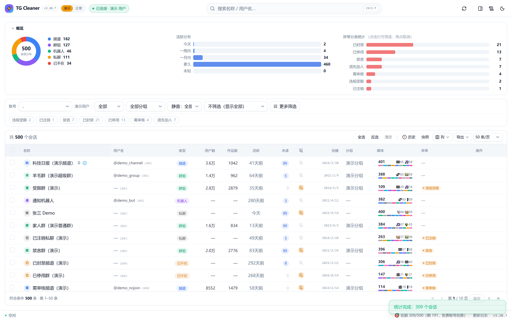
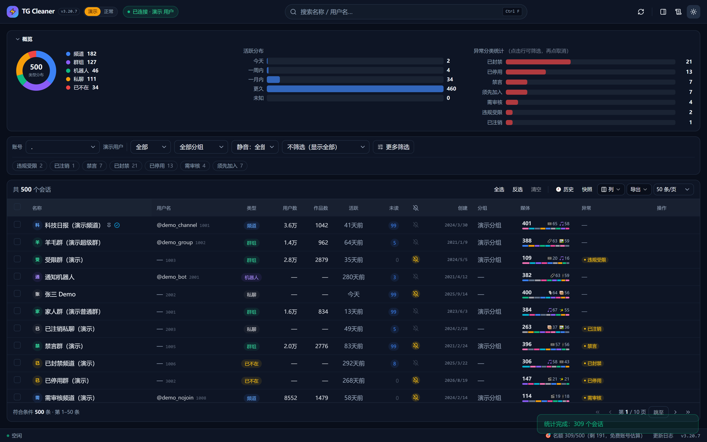
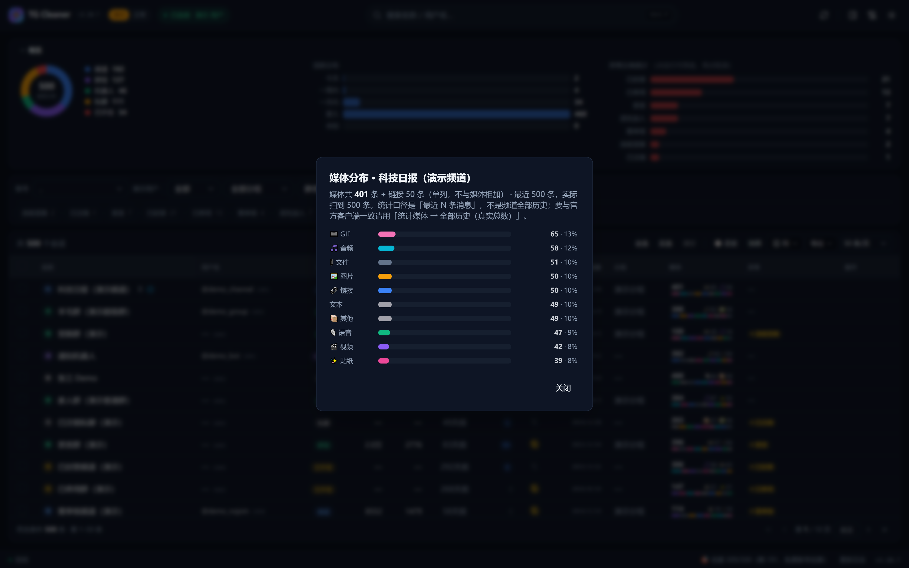
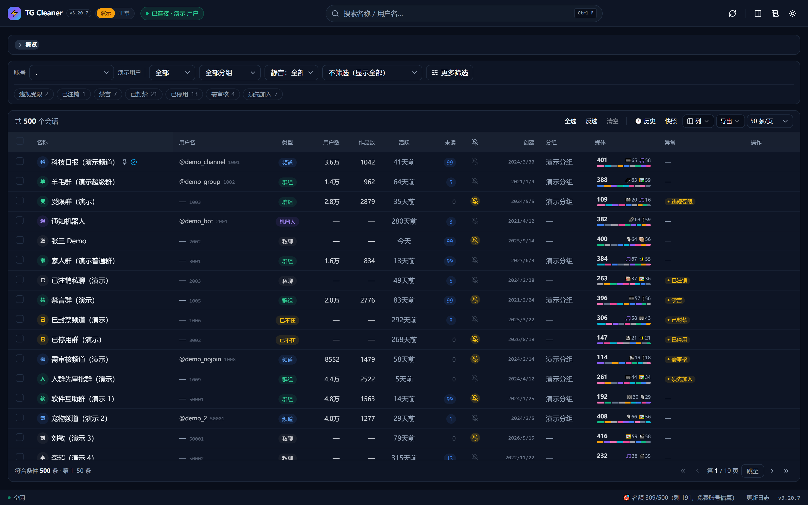

# TG 频道批量退出工具

> ⚡ **Web 版 v3（当前主线）**：React 19 + Tailwind CSS + Framer Motion 前端，
> FastAPI + Telethon 后端，源码在 [`tg-leave-web/`](tg-leave-web/)。
> 一键启动 `tg-leave-web/启动.bat`，浏览器打开 `http://127.0.0.1:8787`；
> **演示模式零凭据**即可体验全部功能（500 条模拟数据）。
> 功能对齐 Python v1.7.7 全集并持续增强：媒体统计（全历史真实总数）/ 快照对比 / 导出 Excel /
> 断点续跑 / 白名单 / 分组 / 设备管理 / 风险识别（只认服务端字段）……
> 当前 **v3.20.7**，详细说明与更新日志见 [`tg-leave-web/README.md`](tg-leave-web/README.md)。

## 界面预览（Web 版 · 演示模式）

| 主界面 · 亮色（概览展开） | 主界面 · 暗色 |
|:---:|:---:|
|  |  |
| **媒体分布详情弹窗** | **列表视图（概览收起）** |
|  |  |

> 一个单文件的 Windows 桌面工具：把账号里**全部会话**一次性列出来，看清类型 / 用户数 / 作品数 / 活跃天数 / 所属分组，勾选后批量**退出**、批量**删除会话**，**批量划分到某个分组**，或**删除自己创建的群组与频道**。
> **支持多账号**：多个账号随时切换，切换时不会退出登录。
> 纯本地运行，不依赖任何第三方服务器。

Telegram 免费账号能加入的**频道 + 群组**上限是 **500** 个（Premium 会员为 1000）。但官方客户端**没有多选、没有批量退出**，也没有任何方式让你在列表里分辨哪个是几万人的大群、哪个是 200 人的僵尸群。这个工具就是补上这块。

## 功能

### 多账号（切换不退出登录）

- 可以添加**多个账号**，在列表上方的下拉框里随时切换，双击账号列表也能切
- **切换时不会退出登录**：每个账号的登录态各自保留，切回来**直接可用，不用再收验证码**；连接也尽量复用，切号几乎瞬时
- **每个账号一套独立数据**：白名单、统计缓存、角色缓存、筛选条件、抓取配置互不干扰 —— 换账号不会看到上一个账号的缓存，也不会用错条件去筛错数据
- 「账号」页就是账号管理器：添加账号 / 切换到选中 / 移除账号 / 移除并删登录态，每个账号单独显示手机号与连接状态
- API ID / HASH 与代理是**全局**的（一个 Telegram 应用本来就能登录多个手机号），改一次对所有账号生效
- 旧版本的单账号数据会**自动升级为第一个账号**，登录态原样保留，不用重新登录

### 列表与数据

- 分页加载**全部会话**（频道 / 超级群 / 普通群 / 私聊 / 机器人，几百上千个也不卡）
- 列：名称 / 用户名 / **类型** / 用户数 / 作品数 / **活跃(天前)** / **分组** / **异常** / ID / 安全
- **列表上方的类型统计条**：一眼看清各类各有多少 —— `共 480 个 │ 📢 频道 225 个　👥 群组 225 个　💬 私聊 30 个　🤖 机器人 0 个　🚫 已不在 0 个`；筛选生效时同时给出「显示 N / 共 M」以及**当前显示出来的那批**的类型分布
- 点表头排序；批量获取**用户数**、**作品数**（消息总数）与**最后消息时间**，支持并发数与本地缓存（默认 24 小时）
- 导出 CSV / **Excel(.xlsx)**：当前显示 / 全部 / 仅已勾选（含「异常特征」列）
- Excel 会多带两张表：**统计概览**（总数 / 类型分布 / 用户数量级 / 活跃度 / 异常特征 / 订阅名额）
  与**异常明细**（每个异常会话的每条原因各一行）；清单表已设好表头样式、冻结首行、
  自动筛选、列宽，数字列是**真数字**（可直接排序 / 求和 / 做透视表）
- **工具提示**：鼠标停留 0.45 秒，关键按钮都有说明；**F1** 打开快捷键面板；
  未加载时列表区显示**三步走引导卡片**
- **日志面板可过滤**：按级别（信息 / 警告 / 错误，前缀自动分级）+ 关键词搜索 + 一键复制全部；
  过滤只改显示、不改已写入的记录；自动滚动可关

### 搜索与筛选

- 搜索：按名称 / 用户名匹配
- **类型筛选**：全部 / 频道 / 群组 / 私聊 / 机器人 / 已不在
- **分组筛选**：全部分组 / 未分组 / 任意自定义分组
- **活跃天数控**：`活跃(天) > N` —— 只关心「多久没动静」，不设上限方向
- 快捷筛选预设（各条件之间是「且」）：用户数 / 作品数 / 活跃天数的单条件与组合；也支持自定义
- 「应用筛选并全选」一步到位；「只看已勾选」快速复核；「隐藏受保护项」屏蔽不敢动的行
- **空会话预设**：「空会话（作品数 = 0）」「空会话且 >90 天没消息」—— 僵尸会话最典型的判据

### 🎨 界面

- **设计令牌驱动**：间距只有 4 / 8 / 12 / 16 四档、字号 3 档、颜色 33 个语义令牌
  （页面 / 卡片 / 次级条三级底色，文字三级，主色 / 危险 / 警告 / 成功）
- **扁平自绘主题**：不用系统默认外观，按钮分三级 ——
  次要（白底细边）· **主操作（蓝底：连接 / 获取统计 / 退出选中）** · **破坏性（红底：删除）**；
  带 hover / 按下 / 禁用态；输入框焦点变主色；表格行高 26、表头扁平、选中主色淡底
- **统一字体**：自动挑可用字体族（微软雅黑 UI → 雅黑 → Segoe UI → …），中英文都不再退化成宋体
- **深浅两套主题**：令牌键完全一致，切换时菜单、下拉列表、日志、图表文字、提示框一起跟着变
- **换背景图片**（「外观」页 → 选择图片）：按窗口尺寸**居中裁剪铺满**，窗口缩放自动重新适配；
  路径自动记住，下次启动恢复。⚠️ 支持 **PNG / GIF / PPM** —— Tk 读不了 JPG，
  选到 JPG 会明确提示「先转成 PNG」

### 📐 窗口缩放（不会再有按钮点不到）

- **四排横排控件都会自动折行**：顶部筛选条、表格上方的选择/筛选条、底部操作条、日志面板头部。
  窗口拉窄或左侧设置栏展开时，放不下的按钮移到下一行 ——
  **不会出现「按钮被窗口边缘挡住 / 被挤成一条、点不到」**
- 包括「📁 分组 ▾」这类：以前左侧设置栏一展开它就被挤成 32px 宽，
  看起来像功能没了
- 「类型: + 下拉」「分组: + 下拉」「退出间隔(秒): + 输入框」绑成一组，
  折行时**不会被拆到两行**
- 测试里有**通用扫描**：遍历整棵控件树，任何超出父容器右边界的控件都会被判定为失败；
  跑「左栏开合 × 5 档窗口宽度」共 10 种布局组合

### 🧭 出错时看到的是人话

报错不会甩英文给你看。工具会把**可预期的错误**翻成一句中文 + 下一步：

| 情况 | 界面上显示 |
|---|---|
| 网络 / 代理不通 | 连不上 Telegram（网络或代理不通）—— 检查代理设置后再试 |
| 登录态失效 | 登录态已失效（session 被撤销，或在别处退出过）—— 请重新登录这个账号 |
| 被限流 | 被 Telegram 限流了，需要等 30 秒（等完再试即可） |
| 两步验证 | 该账号开了两步验证，需要填两步密码 |
| api_id 错 | api_id / api_hash 不正确 —— 去 my.telegram.org 核对后再填 |
| 邀请链接失效 | 邀请链接已过期 |
| 频道不可访问 | 该频道已不可访问（被封 / 设为私密 / 你被拉黑） |

**认不出来的错误会原样显示**（不假装认识 —— 方便你照原样去搜），
但不会再出现裸的 `ChannelForbidden`、`RPCError`、`type(e).__name__` 这种我们内部的词。

### 📄 导出：CSV 与 Excel

「导出 CSV ▾」菜单里六项 —— 两种格式各三档范围（当前显示 / 全部 / 仅已勾选）：

| | CSV | Excel(.xlsx) |
|---|---|---|
| 适用范围 | 喂给别的脚本、导入数据库 | 自己看 / 交给人看 / 做透视表 |
| 工作表 | 单表 | **会话清单 + 统计概览 + 异常明细** |
| 表头样式 / 冻结首行 / 自动筛选 / 列宽 | — | ✅ |
| 数字类型 | 全是文本 | 用户数 / 作品数 / 活跃 / ID 是**真数字**（千分位） |

- **没统计过的行留空，不写 0** —— 写 0 会让「没统计过」看起来像「真的是 0 个」；
  「无消息」写成文字，而不是 1000000000 天
- 导出完问一句「现在打开吗」，**不擅自**弹程序
- **零依赖**：没有引 openpyxl，xlsx 是自己按 OOXML 写出来的（`zipfile` + XML），
  exe 体积不受影响。测试里连「包结构自洽」都当断言：XML 都能解析、
  Content_Types 声明的部件都存在、workbook 引用的 rId 都有对应关系
  —— 这三样任一不对，Excel 会直接说文件损坏
- 以 `=` / `+` / `@` 开头的频道名在 CSV 里会被 Excel 当公式执行，所以 CSV 那条加了防护；
  **Excel 这条路天然免疫**（xlsx 里公式必须写在 `<f>` 元素中，内联字符串永远只是字符串）

### 📊 数据概览（Ctrl+D）

- 四张图：**类型分布**（环形）、**用户数量级**、**活跃度**（最近消息）、**异常特征**
- 全部用 Canvas 手绘，**零依赖、零请求**（数据就来自当前列表）
- 「用户数还没获取」的会话单独计数 —— 不混进「0 个」里骗人

### ⏯ 批量任务可续跑

- 开跑前先把「要处理哪些」写盘，每完成一个就记一次
- 中断 / 崩溃 / 关窗口之后：「⏯ 任务 ▾ → 继续上次未完成的」把剩下的行勾出来接着做
  （**只勾选，不替你直接开跑**）
- 进度条上带 ETA：「剩余约 4 分 · 1.2 个/秒」

### 📱 登录设备管理

- 左侧「设备」页列出当前账号的登录设备：设备 / 系统 / IP / 国家 / 最近活跃，本机带标记
- 「踢出选中」「踢出其它全部」——**本机那条永远不会被踢**，踢之前有确认清单
- 只用 `account.getAuthorizations` / `resetAuthorization`，**只动自己的账号**

### 📸 快照与对比

- 「导出 CSV ▾ → 导出快照 JSON」存一份当前状态
- 「与上次快照对比」输出五类差异：**新增 / 消失 / 改名 / 用户数变化 / 新增异常**（明细写日志）

### 🔕 静音 / 归档（不退出）

- 给「太吵但不想退」的会话一个**可逆**的中间选项：静音、取消静音、归档、移出归档
- 不改变列表内容，也不动任何记录（`account.updateNotifySettings` / `folders.editPeerFolders`）

### 🎯 订阅名额（500 / 1000）

- 统计条尾部直接显示 `🎯 名额 466/500（剩 34，按免费账号估算）` ——
  这工具本来就是为「订阅满 500 加不进去」而做，所以把「用了多少、还剩多少」摆在最显眼处
- 上限按 `me.premium` 取 **500 / 1000**。⚠️ 这个上限是**客户端侧的知识、服务端不返回**，
  所以文案写成「按…估算」，不假装它是服务端权威值
- 批量退出结束后日志会报「🎯 本次腾出 N 个名额」

### 🕘 退出历史与重新加入（后悔药）

- 退出 / 删除是**不可逆**操作，所以本工具给一次后悔的机会：经**服务端复核确认**的退出 / 删除
  会记进 `tg_history_<账号>.json`（只记 id / 名称 / 用户名 / 类型 / 时间，不含敏感内容）
- 「🕘 历史 ▾」菜单（快捷键 **Ctrl+H**）：
  - 查看最近 20 条（时间 / 名称 / 类型 / **能否重加**）
  - **重新加入历史里可重加的全部** —— 公开频道 / 群组走 `channels.JoinChannelRequest`
  - **从链接 / 用户名重新加入** —— 粘贴 `t.me/xxx`、`@name`、`t.me/+邀请码` 批量加入；
    邀请码先 `CheckChatInviteRequest` 预检，过期了直接说清原因
  - 复制全部重新加入链接 / 清空历史
- **私有邀请链接进的频道、已注销的频道明确标「不可重加」** —— 不假装能救回来

### 🚫 异常筛选（违规 / 已封禁 / 不可关注）

一键筛出「留着没用、还可能拖累账号」的会话。**特征全部来自 Telegram 已经给我们的实体字段，
零请求**，列表加载完就已经算好了：

| 「异常」列显示 | 判定依据（服务端字段） | 含义 |
|---|---|---|
| 已封禁 | `ChannelForbidden` / `ChatForbidden` | 已不可访问：被封 / 被踢 / 频道已删 |
| 违规受限 | `restricted` + `restriction_reason` | 服务端标注受限（**版权投诉 / 违反服务条款 / 色情** …，reason 代码优先，文案兜底） |
| 诈骗 / 假冒 | `scam` / `fake` | Telegram 官方标记 |
| 已停用 | `Chat.deactivated`、`Channel.left` / `Chat.left` | 群已停用，或你已不在（会话条目残留） |
| 禁言 | `banned_rights` / `default_banned_rights.send_messages` | 你被禁言，或全员默认禁言 |
| 需审核 / 须先加入 | `join_request` / `join_to_send` | 不能直接关注、必须先加入才能发言 |
| 已注销 | `User.deleted` | 对方账号已注销（灰头像 / 纯数字名） |

同一行命中多类时，列里**把全部类别并排**（`诈骗 · 违规受限 · 禁言`）—— 不用去别处查还有哪些。
右键「**为什么异常**」把每一条原因逐条写进日志，**服务端原文单独缩进一行**
（中文说明和英文原文不混在一句里，那样最难读）。

导出的 Excel 里有专门的「**异常明细**」表：**异常类别 / 判定依据 / 服务端原文** 分成三列
（每个异常会话的每条原因各占一行）。

「🚫 异常 ▾」菜单（每项都带**实时**计数）：

- **只看**：违规 / 被封（全部）、已封禁、违规受限、诈骗 / 假冒、已停用、被禁言、
  不能关注 / 须先加入、对方已注销、任意异常；以及「清除异常筛选」
- **勾选全部异常行**（含被筛选藏起来的行；白名单 / 创建者 / 管理员照样跳过，但会把跳过数写清楚）
- **把异常统计写进日志**：共 N 个会话、命中 M 个、逐类明细
- **记住这些异常（写入白名单）**：想留下其中一部分时先圈出来，白名单行永不被批量退出 / 删除

> 为什么不用关键词猜名字？靠标题里出现「福利 / 资源」这类词判违规，会把大批正常频道误判成
> 违规 —— 所以这里**只认服务端标记**，判不了就明说判不了。导出的 CSV 也会带上「异常特征」列
> （含完整原因），可以先看清单再决定要不要动手。

### 退出 / 删除选中（一个按钮吃下全部会话类型）

Telegram 里只有**频道 / 群组**谈得上「退出」，**私聊和机器人根本没有这个概念**。所以这个按钮会按类型自动分派，而不是勾到私聊就整批报错：

| 你勾的是 | 实际做的事 |
|---|---|
| 频道 / 超级群 / 普通群 | **退出** —— 不再是成员 |
| 私聊 / 机器人 | **删除会话** —— 只清掉你这边（Telegram 对它们只提供这一种动作） |
| 已不在 | 跳过（本来就没什么可做的） |

确认窗会直接告出「退出 N 个、删除 N 个」，不会让你猜。日志里也分得清楚：

```
✅ 已退出: 某频道
🗑 已删除会话（服务端已复核确认）: 某人
```

- 全选 / 反选 / 清空全部；勾选只作用于当前显示的行，被筛选隐藏的勾选项会单独提示
- **按关键词批量处理**：名称或用户名包含任一关键词即匹配，逗号或空格分隔
- 退出间隔（默认 2 秒）+ 随机抖动；触发 FloodWait 时自动等待并重试
- **删完会回头问服务端「这个会话真的没了吗」**，只有服务端确认了才写「已删除」；
  没成的话该行会**留在列表里**，并说明原因（详见下面「删除会话」一节）

### 删除会话（含聊天记录）

- 私聊 / 机器人：**删除会话** —— 只清掉**你这边**的会话与聊天记录，对方完全不受影响
- 频道 / 群组：**退出** —— Telegram 里这类会话只有退出才会从列表消失，
  此前对它们发「删除会话」服务端收下却不执行（确认窗会逐类写明后果）
- ⚠️ **不做「看起来成功」的假动作**：删除请求发出去之后会回头问服务端
  「这个会话还在吗」，只有确认没了的才写「已删除」。
  仍在的会按顺序换 5 种写法重试（显式 InputPeer / 带 top_message 当 max_id /
  Telethon 高层接口 / 带 revoke=True / **临时封禁 → 解封 → 再删**），
  每换一步都重新问一次服务端；全部无效就如实报「未能删除」，
  该行**留在列表里**，并给出**实测**诊断（抽查 getHistory，看记录还剩几条，而不是猜）
- **已知的两类「删了记录、却摘不掉会话条目」**（日志里表现为：服务端说会话还在，
  但它的 top_message 是 0 —— 记录其实已经删掉了）：

  | 情况 | 工具怎么处理 |
  |---|---|
  | 对方账号**已注销**（Deleted Account，客户端里是灰头像 / 纯数字名） | Telegram 只删记录、**保留会话条目**。工具会改用 `revoke=True`（对方账号已不存在，删无可删）与「临时封禁 → 解封 → 再删」（重置服务端对该 peer 的会话状态）这两招再试，每招都复核 |
  | 你自己的「**收藏夹 / Saved Messages**」 | 这个会话 Telegram **不允许删除**；更麻烦的是，请求里「删记录」那一半会**真的清空你收藏的内容**。所以工具对收藏夹**不发任何请求**，直接拦住并告诉你：要清空请到客户端用「清空聊天记录」 |
  | Telegram 官方支持账号 | 本身不允许删除 |

  `revoke=True` 与「临时封禁」两招都带闸门：只对**已注销的幽灵账号**使用，
  对正常在用的联系人会显式跳过并说明原因（不替你去删对方的记录、也不临时封禁陌生人）。

- 遇到「确认仍然存在」而上面又没列出原因时，把程序目录下的
  `tg_leave_log.txt` 发出来即可（里面记了每一步的写法与服务端返回）

### 删除自己创建的群组 / 频道（不可恢复）

- 只有**你本人创建**的才能删；类型（频道 / 群组）分开操作，不会互相误伤
- 视频道/群组对**所有成员**消失，聊天记录一并清除，**无法撤销**
- 三道闸：**类型匹配** → **创建者身份** → **确认窗里必须手打「删除」二字**（确认按钮初始不可点，没有可关闭的开关）

### 分组（Telegram 里叫「文件夹」）

- 「分组」列显示每个会话所属的全部分组（可同时属于多个，用「、」连接）
- 按分组筛选，一键圈出某个分组的全部会话
- **批量划分**：把一批频道 / 群组一次加进或移出某个分组 —— 只改归属，不退出也不删除

  | 怎么操作 | 作用范围 |
  |---|---|
  | 列表里勾选 → 「📁 分组 ▾ → 已勾选的行 ▸ …」 | 勾了哪些就动哪些 |
  | **搜索 / 筛选后 → 「📁 分组 ▾ → 当前筛选 / 搜索结果 ▸ …」** | 直接对整批搜索命中项生效，**不必先挨个勾选** |
  | 「📁 分组 ▾ → 批量划分到分组…」（或 **Ctrl+G**） | 弹窗里自选目标分组与范围，还能看实时预览 |

  三档范围（已勾选的行 / 当前筛选与搜索结果 / 全部会话）**都不跳过受保护项**：
  白名单、创建者、管理员照样能划进分组 —— 「受保护」只对退出和删除有意义。
- **自动复现 Telegram 的分组规则**，所以「靠规则进来的」会话也能正确显示归属，而不是只认手工加进去的那批

  ⚠️ 规则是**按会话类别各查各的开关**，和官方客户端一致：

  | 会话类别 | 看哪个开关 |
  |---|---|
  | 广播频道 | `broadcasts`（频道） |
  | 普通群 / 超级群 | `groups`（群组） |
  | 机器人 | `bots`（机器人） |
  | 用户（在联系人里） | `contacts`（联系人） |
  | 用户（不在联系人里） | `non_contacts`（非联系人） |

  一个类型开关都没勾的分组 = **纯手工**，只显示你亲手加进去的那些。
  另外 `exclude_read`（仅保留未读）/ `exclude_muted`（排除已静音）/ `exclude_archived`（排除已归档）在这些条件之上再过滤。
- **日志里会逐个打印每个分组到底开了哪些开关**，例如：
  ```
  ✅ 已读取 3 个分组（1 个纯手工、2 个带自动规则）：
     · personal —— 规则：非联系人，另手工加入 12 个
     · 工作 —— 规则：群组 + 频道 + 排除已归档
     · 收藏 —— 规则：无自动规则（纯手工）
  ```
  某个分组「显示出了所有」时，看这行就知道是规则本身宽，还是别的问题。
- **带规则的分组里「移出」是有效的**：靠规则进来的会话光从手工名单里删掉会被规则捞回来，
  本工具会把它写进**排除名单**（`exclude_peers`）才真正移出，并在日志里说明有多少个属于这种情况。
- **Telegram 的「共享分组」（chatlist）只读**：它能出现在分组列与筛选下拉里，但成员由服务端维护，本工具不会对它做「加入 / 移出」，以免改坏。
- 本工具**不会替你在服务端新建分组**（新建要自己生成分组 id，撞上其它设备刚建的分组会把它覆盖掉，风险不值得冒）。请先在 Telegram 客户端里建好分组，再点「重新读取分组列表」。

### 安全防护

- **白名单**：加入白名单的会话永不退出、也不被删除会话（按 ID 记录，跨刷新、跨重启保持）
- **自动识别创建者 / 管理员并跳过**：这两类身份在 Telegram 里无法退出，提前识别避免白跑一轮
- **删除 / 销毁前预览清单**：分「将执行」/「已跳过」两个页签，写清每一项被跳过的原因
- 删除类操作**不受白名单之外的保护名单阻拦** —— 你创建的频道本来就不允许退出，删除是唯一的清理手段

### 其他

- 代理支持：SOCKS5 / SOCKS4 / HTTP，内置「测试代理」真实出网验证
- 深色模式、记住窗口大小 / 列宽 / 面板开合
- 运行日志（可清空 / 导出 / 自动滚动）
- 快捷键：`Ctrl+F` 搜索、`Ctrl+A` 全选、`空格` 勾选、`F5` 刷新、`Esc` 清搜索、
  `Ctrl+G` 批量分组、`Ctrl+H` 退出历史、`Ctrl+D` 数据概览、`Ctrl+L` 清空日志、`F1` 快捷键面板
- 表格右键菜单：勾选、白名单、复制名称 / 用户名 / ID / t.me 链接、只看该类型、只退出 / 只删除这一个

## 版本与更新日志

当前版本 **v1.7.5**。界面上有两个地方能看到版本号：

- **窗口标题**：`TG 频道批量退出工具 v1.7.5`
- **状态栏右下角**：版本号旁边就是「📋 更新日志」按钮，点开是全部版本历史（**离线可看**，不联网）

版本号与更新日志在源码里只有一处真源（`APP_VERSION` / `CHANGELOG`），所以界面、日志、自检三者永远不会互相矛盾 —— 打包后的 `--selftest` 也会校验这一点。

> 命令行还支持 `--version` / `--changelog`（需要控制台，即从源码运行或用调试版 exe；绿色正式版没有控制台窗口）。

完整历史见 [CHANGELOG.md](CHANGELOG.md)。

## 下载使用

**方式一（推荐）**：到 [Releases](https://github.com/xiaolushuo/tg-channel-cleaner/releases/latest) 下载 exe。

**方式二**：直接下载仓库 `dist/` 目录里的 `TG频道批量退出工具.vX.Y.Z.exe`（文件名带版本号，例如当前为 `TG频道批量退出工具.v1.7.6.exe`）。

双击运行即可。**Windows，绿色单文件，不需要安装 Python。**

**遇到问题想看详细报错？** 用下面的命令自己生成一个带控制台的调试版：

```bash
pyinstaller --noconfirm "TG频道批量退出工具_调试版.spec"
```

调试版会把启动过程与完整异常打印在控制台窗口里，反馈问题时贴出来即可。

**想确认打出来的包是否完整？** 任意一个版本都支持自检：

```bash
"dist/TG频道批量退出工具.v1.7.6.exe" --selftest
```

它会检查解释器 / tkinter / telethon 是否被正确打进包、关键请求能否构造、界面骨架能否建起来，然后以**退出码**给出结论（`0` = 通过），并把结果写到 exe 同目录的 `tg_selftest.log`。自检过程会把数据文件重定向到临时目录，**不会碰你的登录态与配置**。

## 使用步骤

1. **获取 API 凭据**：打开 <https://my.telegram.org>，登录后在「API development tools」创建一个应用，得到 `api_id` 与 `api_hash`（**只需一次，所有账号共用**）。
2. **添加第一个账号**：设置栏「账号」页 → 填手机号 → 点「＋ 添加账号并登录」，输入手机验证码（开了两步验证再输密码）。登录态按账号保存在程序目录，之后无需重复输验证码。
3. **想加更多账号**：还是「账号」页，换个手机号再点一次「添加账号并登录」即可。
4. **切换账号**：列表上方的下拉框选一下就行，或者在「账号」页双击某个账号。切换**不会退出**当前账号，切回来即刻可用。
5. **等列表加载完**：会自动分页拉取并显示，加载完自动开始获取用户数 / 作品数 / 活跃时间。
6. **筛选、勾选、操作**：按需排序筛选 → 勾选 → 「🚪 退出 / 删除选中」或「🗑 删除 ▾」→ 看清单确认。
7. **批量划分分组**（可选）：搜索或筛选出目标会话 → 按 **Ctrl+G**（或「📁 分组 ▾ → 批量划分到分组…」）→ 选目标分组和范围 → 确认。只改归属，不影响退出 / 删除。

## 从源码运行

```bash
pip install -r requirements.txt
python tg_channel_leave.py
```

需要 Python 3.9+（GUI 依赖标准库 tkinter，官方 CPython 安装包自带）。

## 自行打包

```bash
pip install pyinstaller
pyinstaller --noconfirm "TG频道批量退出工具.spec"
pyinstaller --noconfirm "TG频道批量退出工具_调试版.spec"
```

## 数据文件

程序会把以下文件写在**自己所在目录**，请勿分享或上传。`<key>` 是账号标识（由手机号去掉符号得到）：

| 文件 | 内容 |
|---|---|
| `tg_session.session` | **旧版**单账号登录态（升级后作为第一个账号继续使用） |
| `tg_session_<key>.session` | 某个账号的登录态，**等同于账号凭证** |
| `tg_cleaner_config.json` | 全局设置（`api_id` / `api_hash` / 代理）+ 账号列表 + 每个账号的白名单与抓取配置 |
| `tg_stats_cache_<key>.json` | 该账号的用户数 / 作品数 / 最后消息时间缓存 |
| `tg_role_cache_<key>.json` | 该账号的创建者 / 管理员识别结果缓存 |

> 每个账号的登录态与缓存都是分开的，删掉某一个账号（选择「移除并删登录态」）不会影响其它账号。

## 注意事项

- 本工具**仅用于管理你自己的账号**，请遵守 Telegram 服务条款。
- 批量操作可能触发 Telegram 风控。**建议退出间隔设置在 2 秒以上**。工具已实现随机抖动与 FloodWait 自动等待，但无法保证 100% 不被限流。
- **创建者 / 管理员无法退出频道**，这是 Telegram 的限制。若频道 / 群组是你自己创建的，只能用「删除我创建的频道 / 群组」把它彻底删掉（不可恢复）。
- **删除会话对频道 / 群组等于退出**。Telegram 里这类会话没有「只从列表隐藏」这个动作 ——
  只有退出才会消失。工具会按类型自动分派，并在确认窗里逐类写明后果。
- **已注销账号的会话**：Telegram 会删掉聊天记录、却把会话条目留着 —— 这是服务端行为。
  工具会试到 `revoke=True` 与「临时封禁 → 解封 → 再删」这些更狠的写法，并以复核结果为准；
  仍不放行的会如实报「未能删除」并留在列表里，**绝不报一个假的「已删除」**。
- **自己的「收藏夹」不要勾**：它删不掉，而且删除请求会清空你收藏的内容 ——
  工具现在会直接拦住它、一个请求都不发。
- 需要代理才能访问 Telegram 的网络环境下，请先在「网络」页配置并测试代理。

## 免责声明

本项目仅供学习与个人账号管理使用。使用者需自行承担操作后果，并遵守 Telegram 服务条款及所在地法律法规。

## License

[MIT](LICENSE)
